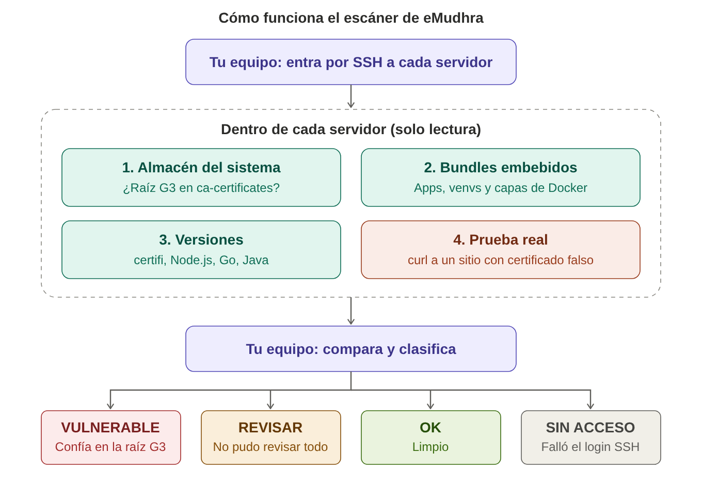

# emudhra-ca-scanner

Escáner sin agente y de solo lectura que encuentra servidores Linux e imágenes de contenedores que todavía confían en la raíz comprometida **emSign ECC Root CA - G3** (compromiso de las CAs de eMudhra, octubre de 2026).



## Contexto

En octubre de 2026 se descubrió que 8 certificados intermedios de la autoridad certificadora eMudhra se firmaron con claves privadas tan débiles que se recuperan en menos de un segundo (una de ellas es literalmente el número `4`). Quien tenga una de esas claves puede emitir un certificado para **cualquier dominio** y los clientes que confían en la raíz emSign G3 lo van a aceptar. Eso permite ataques de intermediario (man-in-the-middle) sin ninguna alerta.

Los navegadores ya bloquean esos intermedios. La exposición que queda está en el software que tiene **su propio almacén de certificados**:

| Componente | Almacén que usa | Corregido en |
|---|---|---|
| Herramientas del sistema (curl, openssl, apt) | `ca-certificates` | Actualizaciones de cada distro (ver [Referencia](#referencia)) |
| Python | `certifi`, también incluido en pip, requests y urllib3 | `certifi 2026.10.19` |
| Go | Dentro de cada binario compilado | Go `1.26.10` / `1.27.3` y recompilar |
| Node.js | Dentro de Node | `22.23.4` / `24.22.1` / `26.12.1` |
| Imágenes Docker | Dentro de cada capa de la imagen | Reconstruir la imagen |

Avisos relacionados:

| Aviso | Componente | Severidad |
|---|---|---|
| [GHSA-6q48-6c7w-9gw2](https://github.com/advisories/GHSA-6q48-6c7w-9gw2) (PYSEC-2026-4320) | Python `certifi` | Crítica, CVSS 4.0 9.1 (CWE-295) |
| CVE-2026-111943 | Go `crypto/x509` | - |
| [GHSA-hq85-5cpj-mr62](https://advisories.gitlab.com/pypi/uv/GHSA-hq85-5cpj-mr62/) | `uv` | - |

## Qué revisa

`emudhra_scan.py` corre en tu equipo, entra por SSH a cada servidor y hace revisiones de solo lectura:

1. **Almacén del sistema:** ¿está la raíz G3 (por su huella SHA-256) en el almacén del sistema operativo? ¿`ca-certificates` está en la versión corregida de la distro?
2. **Bundles embebidos:** cualquier `cacert.pem` o `ca-bundle` dentro de aplicaciones, entornos virtuales y **capas de imágenes de contenedores** (`/var/lib/containerd`, `/var/lib/docker`).
3. **Versiones:** `certifi` (y el archivo que realmente usa), Node.js, Go y el `cacerts` de Java.
4. **Prueba real (opcional):** `curl` desde el servidor a sitios de prueba públicos que presentan un certificado firmado con una de las claves comprometidas. El resultado esperado, y seguro, es un error de certificado.

No instala nada, no modifica nada y borra su archivo temporal al terminar.

## Requisitos

- **Tu equipo:** macOS o Linux, Python 3.8+ y `ssh`. `sshpass` solo si usas contraseña.
- **Servidores:** Linux (Ubuntu, Debian, RHEL/Amazon Linux, Fedora, Alpine, Arch) accesibles por SSH. Se recomienda `sudo`; sin él no se pueden leer las capas de los contenedores.

## Inicio rápido

```bash
git clone https://github.com/victoranibarro/emudhra-ca-scanner.git
cd emudhra-ca-scanner
cp hosts.example.txt hosts.txt      # agrega tus servidores, uno por línea
python3 emudhra_scan.py hosts.txt -u ubuntu -i ~/.ssh/mi-llave.pem --sudo --csv reporte.csv
```

`hosts.txt` acepta `servidor`, `usuario@servidor` y `servidor:puerto`. Las líneas que empiezan con `#` se ignoran.

### Autenticación

| Método | Opciones |
|---|---|
| Llave SSH | `-u ubuntu -i ~/.ssh/mi-llave.pem` |
| Contraseña (la pide una vez) | `-u admin -p` (requiere `sshpass`) |
| Contraseña en CI | `EMUDHRA_SSH_PASS=... python3 emudhra_scan.py hosts.txt -u admin` |
| Varias llaves o usuarios | Defínelos en `~/.ssh/config` y omite `-u` / `-i` |

### Opciones

| Opción | Descripción |
|---|---|
| `--sudo` | Ejecuta las revisiones con sudo (necesario para las capas de contenedores) |
| `--csv ARCHIVO` | Guarda una fila por hallazgo, con todas las rutas afectadas |
| `-v` / `-vv` | Avance en vivo / detalle de la conexión SSH |
| `--fast` | Salta la búsqueda de bundles en disco |
| `--find-timeout N` | Limita la búsqueda en disco a N segundos (por defecto 60) |
| `--no-live-test` | No se conecta a los sitios de prueba de terceros |
| `--tls-ports 443,8443` | Además avisa qué servicios **presentan** un certificado emitido por eMudhra |
| `--tls-only` | Solo la revisión TLS, sin SSH ni credenciales |
| `-j N` | Servidores en paralelo (por defecto 10) |

Código de salida: `0` todo limpio, `1` al menos un servidor vulnerable.

## Resultado

```
────────────────────────────────────────────────────────────────────────
 192.0.2.10   ubuntu 26.04                                   VULNERABLE
────────────────────────────────────────────────────────────────────────
  ✗ Imágenes de contenedores: raíz G3 en 59 bundles de 32 capas
      arreglo: reconstruye las imágenes (docker build --pull --no-cache), despliega y luego docker image prune -a
  ✗ La caché de certificados de snapd contiene la raíz G3
  ✓ Almacén del sistema limpio (ca-certificates 20260816ubuntu0.26.04.1)
  ✓ Python certifi 2026.01.04 (versión vieja, pero usa /etc/ssl/certs/ca-certificates.crt, que está limpio)
  ✓ Prueba real: curl rechaza las dos cadenas falsas

Resumen  VULNERABLE 1   REVISAR 0   OK 0   SIN ACCESO 0
```

| Estado | Significado |
|---|---|
| `VULNERABLE` | Algo todavía confía en la raíz G3 |
| `REVISAR` | No se pudo revisar algo (por ejemplo, sin `--sudo` o con `--fast`) |
| `OK` | Limpio |
| `SIN ACCESO` | Falló el inicio de sesión SSH |

## Verificar dentro de un contenedor

`check_emudhra.sh` prueba cada cliente disponible (curl, openssl, `ssl` de Python, `certifi` y Node.js) desde dentro de un servidor, contenedor o imagen:

```bash
docker run --rm -i --entrypoint bash mi-imagen:tag -s < check_emudhra.sh
docker exec -i mi-contenedor bash -s < check_emudhra.sh
```

## Cómo corregirlo

| Hallazgo | Arreglo |
|---|---|
| Almacén del sistema | `sudo apt update && sudo apt install --only-upgrade ca-certificates` (o el equivalente de tu distro) |
| Python certifi | `pip install -U "certifi>=2026.10.19"` y fíjalo en requirements.txt |
| Imágenes de contenedores | Reconstrúyelas con `ca-certificates` y `certifi` actualizados usando `docker build --pull --no-cache`, y luego `docker image prune -a` |
| Caché de snapd | Aparta `/var/lib/snapd/pki/v1/merged/ca-certificates.crt`, reinicia snapd y confirma que `snap find hello` sigue funcionando |
| Binarios Go | Recompílalos con Go 1.26.10 / 1.27.3 o superior |
| Verificación TLS apagada en el código | Quita `verify=False` / `CERT_NONE` |

Líneas para agregar a un Dockerfile:

```dockerfile
RUN apt-get update && apt-get install -y --only-upgrade ca-certificates && rm -rf /var/lib/apt/lists/*
RUN python3 -m pip install --no-cache-dir -U pip "certifi>=2026.10.19"
```

> **Nota sobre Ubuntu/Debian:** el paquete del sistema `python3-certifi` apunta al almacén del sistema, así que una versión "vieja" es segura si ese almacén está limpio. El escáner revisa el archivo que certifi usa de verdad, no solo su número de versión.

## Limitaciones

- Solo servidores Linux.
- No revisa uno por uno los binarios Go ya compilados ni los keystores personalizados de Java.
- La búsqueda en disco cubre las rutas habituales (`/opt`, `/usr`, `/srv`, `/home`, `/root`, `/var/lib`, `/var/www`, `/app`) y hasta 300 bundles por servidor.
- Parchar una imagen agrega una capa encima. Las capas viejas siguen en el disco y se siguen reportando hasta que la imagen se reconstruye desde su Dockerfile o se "aplana".

## Notas de seguridad

- El escáner es de solo lectura y sin agente: no deja procesos ni puertos abiertos.
- La contraseña se pasa a `sshpass` por una variable de entorno y nunca aparece en la lista de procesos.
- La primera conexión a cada servidor acepta su huella SSH (`StrictHostKeyChecking=accept-new`). Si una huella conocida cambia, la conexión se rechaza.
- **Sobre la prueba real:** los sitios de prueba (`*.we-have-a-problem.com`) los mantiene el investigador que publicó el problema, no este proyecto. Ese sitio ve la IP y la hora de la conexión. `curl` solo pide `/` y descarta la respuesta. Usa `--no-live-test` si tu política no permite conexiones a terceros.
- El `.gitignore` excluye `hosts.txt`, `*.csv` y `*.pem` para que no se suban por error inventarios, reportes ni llaves.

## Referencia

| Componente | Versión mínima corregida |
|---|---|
| ca-certificates Ubuntu | `20260816ubuntu0.<versión>.1` |
| ca-certificates Debian 12 / 13 | `20250419~deb12u2` / `20250419+deb13u1` |
| ca-certificates Alpine | `20261020-r0` |
| ca-certificates Fedora | `2026.2.92_v9.0.319` |
| Python certifi | `2026.10.19` |
| Node.js | `22.23.4`, `24.22.1`, `26.12.1` |
| Go | `1.26.10`, `1.27.3` |

Huella SHA-256 de emSign ECC Root CA - G3:

```
86A1ECBA089C4A8D3BBE2734C612BA341D813E043CF9E8A862CD5C57A36BBE6B
```

### Fuentes

- [GHSA-6q48-6c7w-9gw2: aviso de certifi](https://github.com/advisories/GHSA-6q48-6c7w-9gw2)
- [Sitio de divulgación y sitios de prueba](https://emudhra.we-have-a-problem.com/)
- [Endor Labs: los almacenes que no parchaste](https://www.endorlabs.com/learn/emudhra-intermediate-ca-compromise-the-trust-stores-you-patched-and-the-ones-you-didnt-know-you-had)
- [Help Net Security](https://www.helpnetsecurity.com/2026/10/21/emudhra-certificates-private-keys-compromised/)
- [Keytos: explicación y remediación](https://www.keytos.io/blog/pki/emudhra-ca-key-compromise/)
- [Red Hat RHSB-2026-012](https://access.redhat.com/security/vulnerabilities/RHSB-2026-012)

## Aviso

Se distribuye tal cual, bajo la [licencia MIT](LICENSE). Pide siempre autorización antes de escanear sistemas que no son tuyos.
